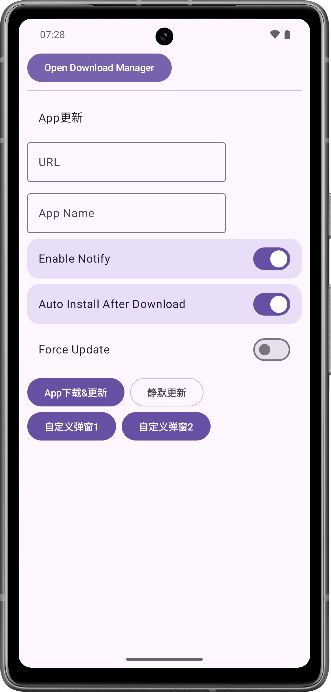
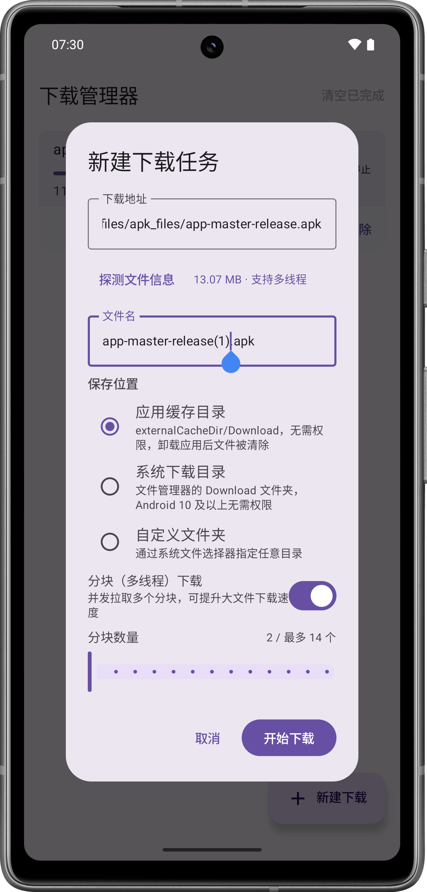
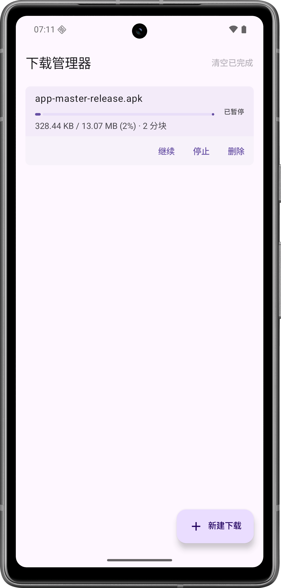
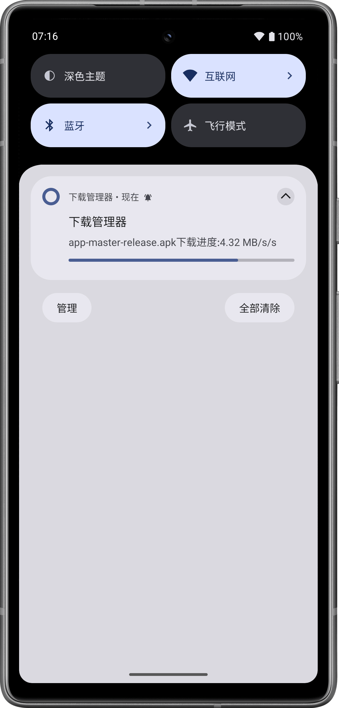
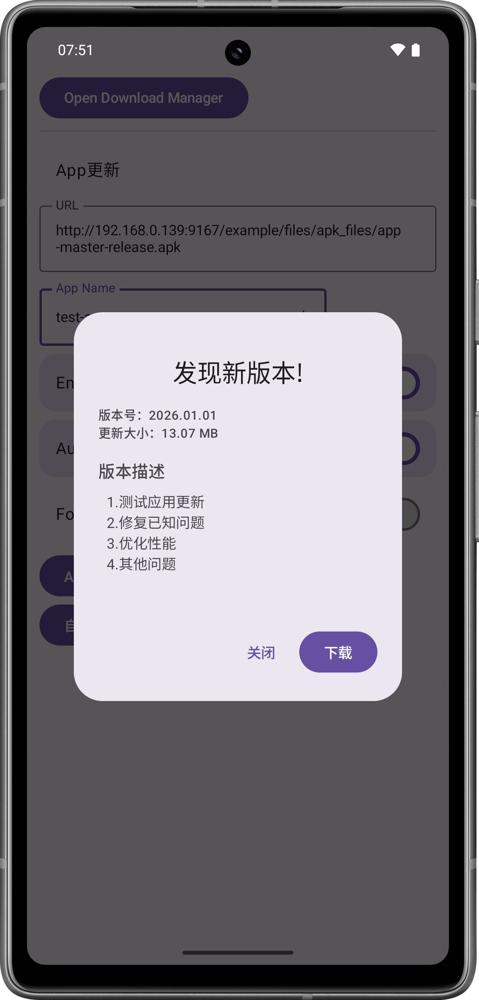
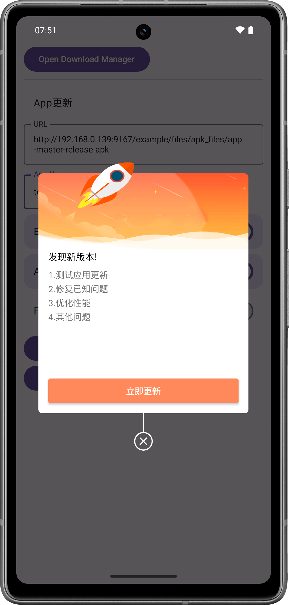
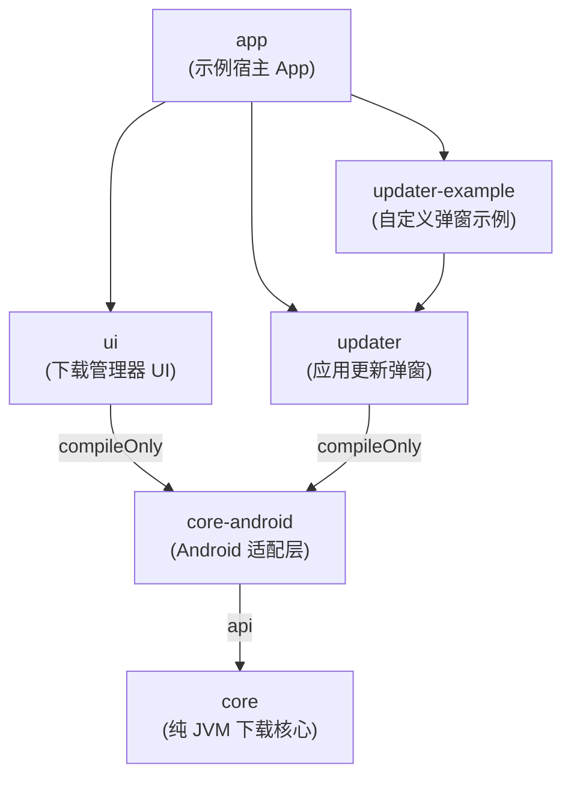

# AndroidDownloader

一个基于 Kotlin 协程 + Flow 构建的 **Android 下载器与应用更新框架**。一套分层清晰的下载解决方案：从纯 JVM 的下载核心，到 Android 前台服务集成，再到开箱即用的应用更新弹窗，每一层都可以独立使用，也可以组合使用。

核心能力：

- **多线程分块下载**（基于 HTTP Range，支持并发分块、速度统计）
- **断点续传**（下载进度快照保存 / 恢复，配合 Room 持久化）
- **任务调度**（最大并发数控制、等待队列、暂停 / 恢复 / 取消）
- **多种文件存储后端**（Java File、MediaStore、SAF `content://` URI）
- **前台 Service 下载**（进程级后台下载 + 通知栏进度）
- **应用内更新**（版本检查后可直接弹出下载更新对话框，支持 MD5 校验、自动安装、完全自定义 UI）

---

|  |   |   |
|---|---|---|
|    |    |   |
|   |    |    |


## 项目架构



依赖方向自上而下单向收敛，`core` 不依赖任何 Android API：

| 模块 | 类型 | 职责 |
| --- | --- | --- |
| `core` | 纯 JVM (Kotlin) | 下载引擎：执行器、任务、调度器、文件存储抽象 |
| `core-android` | Android Library | 将 core 封装为 `DownloadService`，提供 Android 路径 / SAF / 通知能力 |
| `ui` | Android Library | 完整下载管理器界面（Compose + Room + Koin） |
| `updater` | Android Library | App 更新检查 / 下载 / 安装的开箱即用弹窗 |
| `updater-example` | Android Library | 演示如何完全自定义更新对话框 UI |
| `app` | Application | 演示所有模块用法的示例 App |
| `build-logic` | Included Build | 统一的 Maven 发布 Gradle 插件（`publish`） |

---

## 模块详解

### core —— 纯 JVM 下载核心

`core` 是一个 **纯 Kotlin/JVM 模块**（`kotlin("jvm")`），不引入任何 Android 依赖，因此理论上可复用到桌面 / 服务器端。依赖只有 `kotlinx-coroutines`、`okio`、`slf4j-api`。

包结构（`com.github.knightwood.downloader.core`）：

#### `executor` —— 下载执行器

- [IDownloadExecutor](core/src/main/java/com/github/knightwood/downloader/core/executor/IDownloadExecutor.kt)：执行器顶层接口，`download(fileStorage, url): Flow<DownloadStatus>`，并定义 `pause() / resume() / cancel()` 与状态恢复能力（`isSupportRestoreState` / `restoreState`）。
- [DownloadExecutor](core/src/main/java/com/github/knightwood/downloader/core/executor/DownloadExecutor.kt)：单连接顺序下载的基础实现，处理重定向等问题。
- [MultiChuckDownloadExecutor](core/src/main/java/com/github/knightwood/downloader/core/executor/MultiChuckDownloadExecutor.kt)：**分块并发下载器**，核心逻辑：
  1. 探测服务器是否支持 Range，不支持则退化为单连接下载；
  2. `planChunks()` 规划分块区间，每个分块一个协程并发下载，通过 `RandomAccessFileStorage.writeAt()` 写入各自偏移；
  3. 以 200ms 节流向上发射 `DOWNLOADING(status)`，携带瞬时速度、平均速度、每个分块的进度快照（`ChunkProgress`）；
  4. 对返回 200 而非 206 的"伪 Range 支持"服务器直接报错，保证文件布局不被写坏。

#### `filestorage` —— 文件存储抽象

[FileStorage](core/src/main/java/com/github/knightwood/downloader/core/filestorage/FileStorage.kt) 只有极简的 `write / flush / close` 语义，`RandomAccessFileStorage` 额外提供 `writeAt(pos, ...)` 随机写能力——这正是分块下载的基石。`FileStorageFactory` 根据任务配置是否支持分块自动选择实现。这种抽象使得上层（core-android）可以用同一接口适配 Java File、MediaStore URI 与 SAF URI。

#### `task` —— 下载任务

[DownloadTask](core/src/main/java/com/github/knightwood/downloader/core/task/DownloadTask.kt) 是核心门面，负责：

- 将执行器输出的冷流 `Flow<DownloadStatus>` 收敛为 **热流**：`stateFlow`（最新状态）、`progressFlow`（最新进度）、`eventFlow`（状态事件）；
- 提供挂起的 `pause() / resume() / cancel()`——调用后会挂起直到状态真正流转到目标值，保证调用方看到的状态一致性；
- **快照式断点续传**：`saveState()` 返回 `DownloadTaskSaveState`（含 id、配置、进度、终态），新任务通过构造函数传入快照 + `restoreProgress()` 即可从断点继续。设计上有意的取舍是"只恢复进度、不恢复状态"——恢复任务本质是重建一个新任务重新排队，状态从 IDLE 开始即可。

#### `taskmgr` —— 任务调度

[TaskScheduler](core/src/main/java/com/github/knightwood/downloader/core/taskmgr/TaskScheduler.kt) 实现了经典的 **worker 池模型**：

- 预启动 `maxParallel` 个 IO 协程（默认见 `HttpConstant.MAX_PARALLEL_DOWNLOAD_COUNT`），每个 Worker 阻塞在 `waitSignal`（CONFLATED Channel）上；
- 等待队列用 `ArrayDeque<Int>` 而非 Channel，因为需要支持**随机删除**（取消排队中的任务）；
- `submit / enqueue / cancel / delete` 均通过 `Mutex` 保证队列操作线程安全；
- `tasksIn(TaskQueueType)` 按"状态 → 队列类型"映射筛选任务（`mapping2QueueType()`），供 UI 分组展示：等待中 / 下载中 / 暂停 / 完成 / 失败等；
- `saveState() / restoreState()` 将整个调度器（排队顺序 + 所有任务快照）导出 / 还原，UI 层借此实现进程重启后的完整恢复。

#### `model` 与 `util`

- `DownloadStatus`：sealed 状态机（`IDLE / STARTING / DOWNLOADING(progress) / PAUSED / CANCELED / FINISHED / ERROR(e)`）；
- `TaskQueueType`：任务在调度器中的队列归属；
- `DownloadTaskConf` / `DownloadTaskSaveState` / `TaskSchedulerSaveState`：配置与持久化模型；
- `util`：HTTP 工具（Range 探测、分块规划）、下载量格式化（`DownloadFormat`）、MIME 类型、URL 兼容等。

---

### core-android —— Android 适配层

`core-android` 通过 `api(project(":core"))` 向上传递核心能力，解决"在 Android 上如何真正跑起来"的问题：

- **[Downloader](core-android/src/main/java/com/github/knightwood/downloader/core/android/Downloader.kt)**：全局配置单例。控制通知栏开关、最大并发、下载完成后是否自动停止服务、后处理钩子（`postHandler`，例如下载完自动安装 APK）、自定义执行器等。任务级配置 `AndroidDownloadParams` 优先级高于全局配置：

  ```kotlin
  Downloader {
      enableNotification = true
      shutdownAfterDownloaded = true
      postHandler = IDownloadedHandler { context, path, id, conf ->
          // 下载完成后自动安装
          ApkUtil.installApk(context, Downloader.authorities(context), path)
      }
  }
  ```

- **`service/DownloadService` + `DownloadServiceLinker`**：下载运行在 Service 中，`Linker`（一个 `Binder`）是客户端与服务的唯一交互面——`submitTask / enqueueTask / cancelTask / runTaskDirectly / saveState / restoreState`。`Downloader.getDownloadServiceLinker()` 以 suspend 方式绑定服务，并随 `LifecycleOwner` 销毁自动解绑：

  ```kotlin
  val linker = Downloader.getDownloadServiceLinker(context, lifecycleOwner, foreground = false)
  val task = linker.submitTask(id, params)   // 提交即排队下载
  task.stateFlow.collect { /* 观察进度 */ }
  ```

  `runTaskDirectly()` 则允许任务**脱离调度器**在当前协程直接执行（updater 模块的弹窗自管理下载就用的是这条路）。

- **`model/AndroidPath`**：密封类描述三种落盘位置——`Jvm`（普通文件路径）、`MediaStore`、`Saf`（content URI）。因为后两者根本无法反推出"文件夹 + 文件名"，所以路径必须在任务配置中显式给出，而不是由配置拼接。
- **`filestorage/`**：`AndroidUriFileStorage` / `AndroidUriRandomAccessFileStorage` 把 `content://` URI 适配成 core 的 `FileStorage` 接口，使 SAF / MediaStore 下载同样支持分块写入。
- **`INotifier`**：通知栏进度抽象，默认实现 `DefaultDownloadNotifierImpl`，可整体替换。

---

### ui —— 下载管理器界面

`ui` 模块提供一套**完整可用的下载管理 UI**（`DownloadMgrActivity` 为入口），技术栈为 Compose + ViewModel + Room + Paging + Koin：

- **持久层**：`room/` 下的 `DownloadTaskDatabase`（schema 导出在 `ui/schemas/`），包含任务表、分块进度表（`DownloadChunkEntity`，断点续传落库）、SAF 授权表（`SafPermissionEntity`，持久化用户对目录的 URI 授权）、任务分类表。`DownloadTaskMapper` 负责 Room Entity 与 core 模型的互转。
- **仓储层**：`DownloadTaskRepository` 聚合 DAO，向 ViewModel 提供数据流。
- **界面层**：`screen/` 下 `DownloadMgrScreen`（任务列表、分组、操作）、`NewDownloadTaskDialog`（新建任务，支持选择 MediaStore / SAF 存储位置）、`SAFSelectorDialog`、`SettingsScreen`。
- **依赖注入**：`di/` 中的 Koin module 将 `Downloader` 全局配置、Repository 等注入 ViewModel；宿主 App 通过 `DownloaderKoinContext` 与自己的 Koin 容器集成。
- **偏好设置**：`preference/` 抽象出 `IApplicationPreference / IDownloadPreference` 接口 + DataStore 实现，供 UI 读取下载目录、并发数等设置。

> 注意：`ui` 对 `core` / `core-android` 使用 **`compileOnly`** 依赖——编译期可见 API，运行时由宿主 App 负责引入实现，避免库使用者被传递依赖绑架。

集成方式：

```kotlin
// app 的 build.gradle.kts
implementation(project(":core-android"))
implementation(project(":ui"))

// 直接启动下载管理器
startActivity(Intent(this, DownloadMgrActivity::class.java))
```

---

### updater —— 应用内更新

`updater` ：**把一次 App 更新建模为"一个普通下载任务 + 安装后处理"**，复用整套下载能力（断点续传、分块、通知栏）。

- **[AppUpdater](updater/src/main/java/com/github/knightwood/downloader/updater/AppUpdater.kt)**：单例门面，两种使用姿势：
  - `display(fm, paramProvider)`：弹出内置更新对话框，用户点击后才创建下载任务（弹窗内管理任务生命周期）；
  - `secretDownload(...)`：静默开始下载（不弹 UI），之后随时 `AppUpdater.display(fm)` 展示进度；
  - `AppUpdater.TaskControl.pause/resume/cancel/retry/install`：对当前更新任务的统一操作入口；
  - `currTaskFlow: Flow<DownloadTask?>`：把任务状态流暴露给自定义 UI 订阅。

- **`ApkDownloadParams`**：面向"更新"场景的精简配置（url、appName、size、md5、forceUpdate、autoInstallAfterDownload、enableNotify、自定义 notifier），内部由 `mapToAndroidDownloadParam()` 翻译成 `AndroidDownloadParams`——校验文件名必须以 `.apk` 结尾、自动挂接安装 postHandler、缓存目录放在 `externalCacheDir/apks`。

- **下载对话框**：`AppUpdateDialog`（DialogFragment 壳）+ `AppUpdateDialogUI`（Compose 内容），内置强制更新（隐藏关闭按钮）、进度条、暂停 / 继续 / 重试 / 安装按钮的状态联动。

- **安装**：`ApkUtil.installApk()` 通过 FileProvider（authorities 约定为 `包名.fileProvider`，清单见 `core-android` 的 `AppUpdateFileProvider`）发起系统安装 Intent；`internalInstallApk()` 在安装前可做 **MD5 校验**，校验失败拒绝安装。

最小接入示例（同 `app` 模块 [MainActivity](app/src/main/java/com/github/knightwood/downloader/app/MainActivity.kt)）：

```kotlin
// 1. 检查版本后弹出更新对话框
val info = Repo.checkUpdateVersion()          // 自己的接口
if (info.versionCode > ApkUtil.getVersionCode(context)) {
    AppUpdater.display(supportFragmentManager) {
        ApkDownloadParams(
            url = "https://example.com/app-latest.apk",
            appName = "app-latest.apk",
            size = info.size,
            md5 = info.md5,
            forceUpdate = false,
            autoInstallAfterDownload = true,
        )
    }
}

// 2. 或者：后台静默下载，用户点"新版本提示"时再展示进度
lifecycleScope.launch {
    AppUpdater.secretDownload(activity) { apkDownloadParams() }
}
AppUpdater.display(supportFragmentManager)
```

---

### updater-example —— 自定义更新 UI 示例

演示在**不动 updater 内部逻辑**的前提下替换整套更新对话框 UI。两个示例都是 `DialogFragment`：

- **`ColorfulUpdateDialog`**（View 体系 + XML 布局）：
  - `onCreateDialog` 中绑定 `AppUpdater.currTaskFlow`，在 `repeatOnLifecycle(STARTED)` 中收集 `combine(stateFlow, progressFlow)`，按状态切换按钮文案（立即更新 / 暂停 / 继续更新 / 重新下载 / 立即安装）并刷新 `NumberProgressBar`；
  - 点击按钮全部转发给 `AppUpdater.TaskControl`（`secretDownload / pause / resume / retry / install / cancel`）；
  - `forceUpdate = true` 时隐藏关闭按钮并禁止取消。
- **`FullScreenUpdateDialog`**：全屏样式的变体，验证同一套状态流可以驱动完全不同的布局（含横竖屏、sw600dp 平板适配资源）。

结论：**UI 与下载逻辑完全解耦**——只要你订阅 `AppUpdater.currTaskFlow` 并调用 `TaskControl`，任何 UI（View / Compose / 第三方弹窗库）都能接入。

---

### app —— 示例宿主

演示三种入口：打开 `DownloadMgrActivity`（完整下载管理器）、`AppUpdater.display/secretDownload`（内置更新弹窗）、`ColorfulUpdateDialog / FullScreenUpdateDialog`（自定义弹窗），并提供更新源地址、MD5、强制更新等设置页。

---

## 技术栈与构建

| 项 | 值 |
| --- | --- |
| 语言 | Kotlin 2.2.10 |
| 异步 | kotlinx-coroutines 1.10.0（Flow / StateFlow / Mutex / Channel） |
| IO | okio 3.10.2 |
| 日志 | slf4j-api（Android 端桥接 `uk.uuid.slf4j:slf4j-android`，JVM 端 logback） |
| UI | Jetpack Compose (compose-bom) + Material3，部分 View/XML |
| 存储 | Room 2.8.5（KSP）、DataStore、Paging 3 |
| DI | Koin 4.x（含 koin-compose-viewmodel） |
| 构建 | AGP 8.10.0、Gradle Version Catalog（`gradle/libs.versions.toml`）、`TYPESAFE_PROJECT_ACCESSORS` |
| minSdk | core: JVM / core-android: 16 / 其余库与示例: 24 |
| 发布 | `build-logic` 中的Convention 插件 `publish`（vanniktech-maven-publish），group `com.github.knightwood.downloader`，version 见根目录 `gradle.properties`；亦支持 JitPack（`jitpack.yml`） |

编译运行：

```bash
# 构建示例 App
./gradlew :app:assembleDebug

# 发布 core / core-android / ui / updater 到本地 Maven（坐标见 gradle.properties）
./gradlew :core:publishAllPublicationsToMyLocalMavenRepository
# 或使用脚本
./maven_publish.sh
```

~~通过 JitPack 引入（以根项目坐标为例）：~~
新版本还未发布
```kotlin
implementation("com.github.knightwood.downloader:core:<version>")
implementation("com.github.knightwood.downloader:core-android:<version>")
implementation("com.github.knightwood.downloader:ui:<version>")
implementation("com.github.knightwood.downloader:updater:<version>")
implementation("com.github.knightwood.downloader:updater-example:<version>")
```

---

## 设计要点小结

1. **分层解耦**：`core` 不知道 Android 的存在；Android 特性（Service、SAF、通知、FileProvider）全部收敛在 `core-android`；`ui` 与 `updater` 互不依赖，都只面向 `core-android` 的 API。
2. **一切皆 Flow**：执行器输出 `Flow<DownloadStatus>`，任务包装成 `StateFlow`，UI（包括 updater-example）只订阅流、调用挂起函数，没有回调地狱，也没有事件总线。
3. **状态机驱动**：`DownloadStatus` sealed 类 + `TaskQueueType` 映射，让"任务处于哪个队列 / 该显示什么按钮"这类逻辑有单一事实来源。
4. **快照式持久化**：不试图序列化运行中的任务，而是 `saveState()` 导出纯数据快照，恢复时用快照重建任务并注入进度——简单且对进程被杀免疫。
5. **compileOnly + 宿主注入**：库模块把运行时依赖的选择权交还给宿主 App，减少版本冲突。
6. **可替换点丰富**：执行器（`Downloader.downloadExecutor`）、通知（`INotifier`）、存储后端（`FileStorage` / `AndroidPath`）、后处理（`postHandler`）、UI（updater-example 模式）均可自定义。

## License

[Apache-2.0](LICENSE)
